# Ecommerce OrderFlow: Architecture and Onboarding Guide

**Version 1.0 · Last updated 2026-07-30 · Status: Phase 1 complete, Phase 2 infrastructure written, Phase 3 in progress**

This document is the single visual and technical reference for the Ecommerce OrderFlow
project. It is written for someone who is completely new to software engineering, so every
technical term is explained the first time it appears. Experienced engineers can skip
Part 1 and start at Part 2.

---

## Table of contents

**Part 1: Foundations**
1. [What this project is](#1-what-this-project-is)
2. [Concepts you need first](#2-concepts-you-need-first)

**Part 2: Architecture**
3. [The big picture in six boxes](#3-the-big-picture-in-six-boxes)
4. [The full architecture diagram](#4-the-full-architecture-diagram)
5. [Component reference: what each piece does and why](#5-component-reference-what-each-piece-does-and-why)
6. [The data model](#6-the-data-model)
7. [The order lifecycle](#7-the-order-lifecycle)

**Part 3: How a request travels**
8. [Flow A: signing in](#8-flow-a-signing-in)
9. [Flow B: reading data](#9-flow-b-reading-data)
10. [Flow C: changing an order](#10-flow-c-changing-an-order)
11. [Flow D: background work](#11-flow-d-background-work)

**Part 4: Running and shipping it**
12. [Deployment topologies](#12-deployment-topologies)
13. [The CI/CD pipeline](#13-the-cicd-pipeline)
14. [Running it on your own machine](#14-running-it-on-your-own-machine)

**Part 5: Project status**
15. [What has been implemented](#15-what-has-been-implemented)
16. [Features completed](#16-features-completed)
17. [Features remaining](#17-features-remaining)
18. [Known limitations](#18-known-limitations)
19. [Future roadmap](#19-future-roadmap)

**Part 6: Testing**
20. [Tests already performed](#20-tests-already-performed)
21. [Tests still required before production](#21-tests-still-required-before-production)

**Part 7: Google Cloud deployment guide**
22. [Prerequisites](#22-prerequisites)
23. [Google Cloud services used](#23-google-cloud-services-used)
24. [Environment variables and secrets](#24-environment-variables-and-secrets)
25. [Step by step deployment](#25-step-by-step-deployment)
26. [Verifying the deployment](#26-verifying-the-deployment)
27. [Troubleshooting](#27-troubleshooting)
28. [Recommended production configuration](#28-recommended-production-configuration)

**Appendices**
- [A. Port and URL reference](#appendix-a-port-and-url-reference)
- [B. Demo accounts](#appendix-b-demo-accounts)
- [C. Command reference](#appendix-c-command-reference)
- [D. Repository map](#appendix-d-repository-map)

---

# Part 1: Foundations

## 1. What this project is

Ecommerce OrderFlow is an **order management system**. It is the screen and the machinery
that a shop's staff use *after* a customer buys something: confirming the order, packing
it, shipping it, marking it delivered, and handling cancellations and returns.

It is deliberately **not** a shopping website. The interesting engineering problem is not
the checkout button. It is making sure that an order can only move through its lifecycle in
ways that are **legal** and **allowed**, that every change is **recorded**, and that the
whole system can be **observed** and **operated** safely.

Three kinds of people use it:

| Person | Role name | What they can do |
|--------|-----------|------------------|
| A shopper | `customer` | Place an order, see only their own orders, cancel while still pending |
| A warehouse worker | `ops` | See all orders, move them through confirm, pack, ship, deliver, and returns |
| A manager | `admin` | Everything, including force cancelling an order that has already shipped |

## 2. Concepts you need first

If you have never built software, read this section. Each concept appears later in the
document.

**Frontend.** The part of an application that runs inside the user's web browser and draws
what they see. Ours is called the *dashboard*.

**Backend.** The part that runs on a server, out of the user's reach. It holds the rules
and the data. A browser can be tampered with by its owner, so anything that must be
trusted has to live in the backend.

**Database.** A program that stores information in an organised way and answers questions
about it. Ours is PostgreSQL. Data lives in *tables*, which are like spreadsheets: a table
called `orders` has one row per order and one column per fact about it.

**API (Application Programming Interface).** A defined way for one program to ask another
program for something. If a website is a shop counter for humans, an API is the trade
counter for other programs.

**GraphQL.** A particular style of API. With older style APIs the server decides the shape
of each response. With GraphQL the client sends a small query describing exactly the fields
it wants, and gets back exactly those fields. For example:

```graphql
query {
  orders {
    id
    status
    customer { display_name }
  }
}
```

**Authentication versus authorisation.** Authentication answers "who are you?" (logging
in). Authorisation answers "are you allowed to do this?" (a customer may not ship an
order). They are different problems and this project handles them in different places.

**Token and JWT.** After you log in, the system gives your browser a **token**: a small
piece of text that proves who you are, so you do not resend your password with every
click. Ours is a **JWT** (JSON Web Token). A JWT carries facts ("claims") such as your user
id and your role, and it is **cryptographically signed**. Signed means a server can check
mathematically that the token was issued by the real login server and that nobody edited it
afterwards.

**OIDC (OpenID Connect).** The industry standard set of rules for how logging in with
tokens should work. Following a standard means we did not invent our own login scheme,
which is one of the easiest things in software to get dangerously wrong.

**Container and Docker.** A container is an application packaged together with everything
it needs to run, so it behaves the same on your laptop and on a server. Docker is the tool
that builds and runs containers. "Containerised" simply means "packaged this way".

**Kubernetes.** A system that runs many containers across many machines, restarts them when
they crash, and scales them up when traffic rises. **Helm** is a packaging tool for
Kubernetes: one Helm *chart* describes all the pieces of an application.

**Infrastructure as Code and Terraform.** Instead of clicking around a cloud provider's
website to create servers, you write the desired infrastructure in files and a tool creates
it for you. Terraform is that tool. The benefit is that the setup is repeatable, reviewable,
and deletable.

**Observability.** The ability to see what a running system is doing. It has three parts:

- **Logs**: a diary of individual events ("order 123 moved to SHIPPED").
- **Metrics**: numbers counted over time ("41 requests per second, 0.3% failing").
- **Traces**: the full path of one single request as it passes through several services,
  with timings for each hop.

**SLO (Service Level Objective).** A written, measurable promise about quality, for example
"99.5% of requests will succeed". The small allowance for failure, the other 0.5%, is
called the **error budget**. It turns "the site feels slow" into a number you can act on.

**CI/CD.** Continuous Integration and Continuous Delivery. Automation that runs on every
code change: it checks the code, runs the tests, and builds the deployable package. It is
the safety net that stops broken code from reaching users.

---

# Part 2: Architecture

## 3. The big picture in six boxes

Before the detail, here is the whole system at the highest level. Follow the numbers.

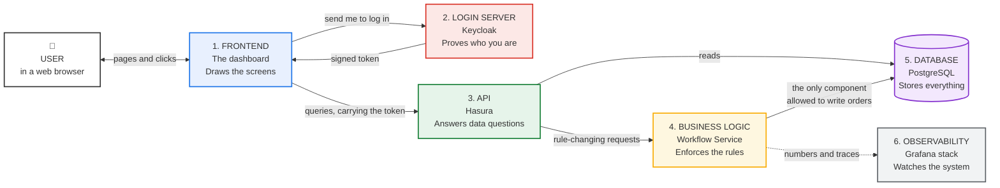

The single most important idea in this diagram: **reading data and changing data take
different paths**. Reads go straight through the API. Changes to an order must go through
the Workflow Service, because that service is the only place the rules live and the only
component permitted to write an order's status.

## 4. The full architecture diagram

This is the same system with every real component, its technology, and its port number. A
**port** is just a numbered door on a machine; different programs listen on different
numbers so traffic reaches the right one.

### 4.1 The request path

This diagram shows every component a user request touches, in the order it touches them.
Observability is a separate concern and has its own diagram in section 4.2, so that the
request path stays readable.

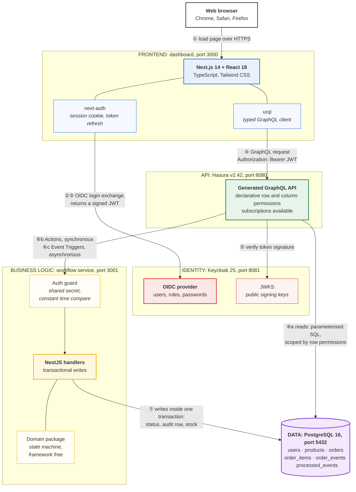

One arrow is deliberately left out to keep the diagram readable: after the Workflow Service
writes an audit row at step ⑦, that insert causes the database to notify Hasura, which then
calls the service back asynchronously. That loop is drawn properly in
[Flow D](#11-flow-d-background-work).

### 4.2 The observability path

The same Workflow Service also emits three kinds of signal. Nothing here is on the critical
path of a user request: if this entire tier were switched off, orders would still work.

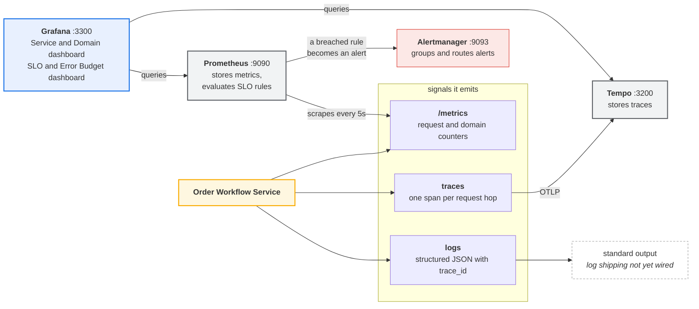

### Reading the connectors

| Symbol | Meaning |
|--------|---------|
| Solid arrow | A direct call. The caller waits for an answer. |
| Dotted arrow | An indirect or background relationship. Nobody is waiting. |
| Circled number | Step order in a normal request. See Part 3. |
| Label on an arrow | The protocol or the payload travelling along it. |

### Trust boundaries

A trust boundary is a line where you must stop believing what you are told and start
checking. There are three:

1. **Browser to Keycloak.** The browser never sees another user's password. Keycloak is the
   only component that checks passwords.
2. **Browser to Hasura.** Everything arriving from a browser is treated as untrusted.
   Hasura verifies the JWT signature against Keycloak's public keys and derives the role
   and the user id from the token, never from anything the page claims about itself.
3. **Hasura to Workflow Service.** The Workflow Service is not reachable from the internet.
   It only accepts requests carrying a shared secret that Hasura attaches on the server
   side, and it derives the acting user from Hasura's forwarded session variables rather
   than from the request body.

## 5. Component reference: what each piece does and why

### 5.1 Dashboard (frontend)

- **Technology:** Next.js 14, React 18, TypeScript, Tailwind CSS, urql, next-auth.
- **What it does:** renders three screens. A list of orders, a single order with its line
  items and full history, and a form to place a new order.
- **Why it exists:** humans need a way to drive the workflow. It is intentionally plain:
  neutral colours, a single accent, no decoration that does not carry meaning.
- **How it communicates:** it sends GraphQL queries to Hasura over HTTPS, attaching the
  JWT on every request. It never talks to the database or the Workflow Service directly.
- **A detail worth understanding:** the buttons shown on an order (Confirm, Pack, Ship,
  Cancel, and so on) are **calculated from the same shared state machine the backend
  uses**. The frontend cannot invent an illegal action, and the backend re-checks every
  action anyway. The frontend rule is a convenience; the backend rule is the law.

### 5.2 Keycloak (authentication)

- **Technology:** Keycloak 25, an open source identity provider, configured from a
  committed realm file.
- **What it does:** stores users and their roles, shows the login form, checks passwords,
  and issues signed JWTs.
- **Why it exists:** writing your own login system is a well known source of serious
  security bugs. Using a standard OIDC provider means password handling, token signing,
  and key rotation are solved by dedicated software.
- **How it communicates:** the browser is redirected to it to log in. Hasura fetches its
  public keys over HTTP to verify token signatures. The dashboard's server side exchanges
  an authorisation code for tokens and later exchanges a refresh token for a new access
  token.
- **A detail worth understanding:** each Keycloak user's internal id is deliberately set to
  the same value as the matching row in the database `users` table. Because of that, the
  `sub` claim in the token can be compared directly against `orders.customer_id`, and no
  separate user synchronisation service is needed.

### 5.3 Hasura (API layer)

- **Technology:** Hasura GraphQL Engine v2.42, running from an image that also carries the
  database migrations and metadata.
- **What it does:** three jobs. It generates a complete GraphQL API from the database
  schema, so no handwritten code is needed for ordinary reads. It enforces **row and column
  level permissions** from the token claims. It forwards business operations to the Workflow
  Service as Actions and Event Triggers.
- **Why it exists:** most of a data API is repetitive. Generating it removes hundreds of
  lines of boilerplate and, crucially, makes the access rules **declarative**: they are
  data in a reviewed file rather than logic scattered across handlers.
- **How it communicates:** it speaks GraphQL to the dashboard, SQL to PostgreSQL, and HTTP
  to the Workflow Service.
- **A detail worth understanding:** Hasura is given **no permission at all** to insert,
  update, or delete an order for any role. That is what makes the Workflow Service the sole
  writer. A customer cannot craft a mutation that sets their own order to `DELIVERED`,
  because no such mutation exists for them.

### 5.4 Order Workflow Service (business logic)

- **Technology:** NestJS 10, TypeScript, the `pg` PostgreSQL driver.
- **What it does:** it owns every change to an order. It validates the request, checks the
  state machine, checks the acting role, checks ownership, reserves stock, updates the
  status, and writes an audit row, all inside one database transaction.
- **Why it exists:** business rules need one home. If they were spread between the browser,
  the API layer, and database triggers, no single place could be tested or trusted.
- **How it communicates:** it is called by Hasura in two modes, described in Part 3. It
  writes to PostgreSQL. It exposes metrics for Prometheus and sends traces to Tempo.
- **A detail worth understanding:** a transaction means all of the writes happen or none of
  them do. If stock turns out to be insufficient halfway through confirming an order, the
  status change and the audit row are rolled back too. The order can never end up
  `CONFIRMED` with stock that was never reserved.

### 5.5 Domain package (the rules, in isolation)

- **Technology:** plain TypeScript. No framework, no database, no network.
- **What it does:** it defines the order statuses, the roles, the table of legal
  transitions with the roles allowed to make each one, and a single function
  `applyTransition` that either returns the new status or throws a typed error.
- **Why it exists:** this is the correctness core of the whole project. Keeping it free of
  frameworks and input and output means it can be tested exhaustively in milliseconds, and
  it can be shared with the frontend.
- **How it communicates:** it does not. It is a library that other code calls.

### 5.6 PostgreSQL (database)

- **Technology:** PostgreSQL 16.
- **What it does:** stores users, products, orders, order line items, the append only event
  history, and the record of processed background events.
- **Why it exists:** orders are relational data with strict integrity requirements. A
  relational database can enforce, at the storage layer, that an order item cannot point at
  a product that does not exist.
- **How it communicates:** it accepts SQL from Hasura and the Workflow Service only, over
  the internal network.
- **A detail worth understanding:** money is stored as a whole number of cents, never as a
  decimal fraction. Fractional binary arithmetic cannot represent every decimal exactly, so
  storing prices as fractions eventually produces totals that are off by a penny.

### 5.7 Observability stack

| Component | Job | Why it exists |
|-----------|-----|---------------|
| **Prometheus** | Collects numeric metrics every 5 seconds and evaluates SLO and alert rules | Tells you *that* something is wrong, and how badly |
| **Tempo** | Stores distributed traces | Tells you *where* a slow or failed request spent its time |
| **Alertmanager** | Groups alerts and routes them to a destination | Turns a breached rule into a notification for a human |
| **Grafana** | Queries the above and draws dashboards | One place to look, instead of three |

The Workflow Service also writes **structured JSON logs** that include the current trace
identifier, so a log line can be matched to the exact trace it belongs to.

### 5.8 External and third party components

Being precise about this matters, because an architecture diagram that implies integrations
that do not exist is misleading.

| Category | What is actually used today |
|----------|-----------------------------|
| Third party software we run ourselves | Keycloak, Hasura, PostgreSQL, Prometheus, Tempo, Alertmanager, Grafana |
| Third party hosted services | GitHub (source control), GitHub Actions (CI/CD), GitHub Container Registry (images) |
| Cloud provider services | Google Cloud, defined in Terraform but **not yet applied**. See Part 7. |
| External SaaS integrations | **None yet.** There is no payment provider, no email or SMS provider, and no shipping carrier integration. |

The notification step in the background event handler is a **stub**: it logs that a
notification would be sent. Wiring a real email or messaging provider is listed in the
roadmap, and the stub is the seam where it would attach.

## 6. The data model

Six tables. The diagram shows how they relate; `1` to `many` means one order has many line
items.

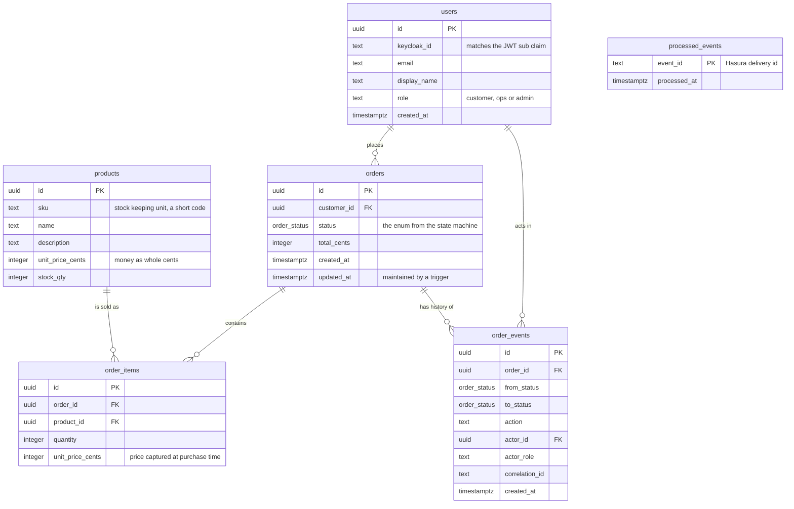

Two design decisions in this model are worth calling out:

**`order_items.unit_price_cents` duplicates the product price on purpose.** Prices change.
An order must always show what the customer actually paid, so the price is copied into the
line item at the moment of purchase and never updated afterwards.

**`order_events` is append only.** Rows are inserted, never modified or deleted. That gives
a complete and tamper evident history of who changed what and when, which is useful for
support, for debugging, and for accountability.

## 7. The order lifecycle

This state machine is the heart of the project. A **state** is a status an order can be in.
A **transition** is a permitted move between two states. The label on each arrow gives the
action name and the roles allowed to perform it.

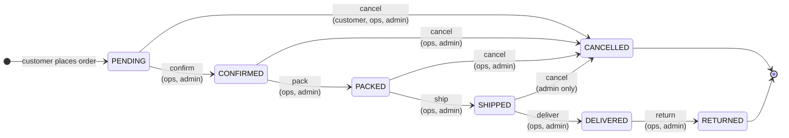

The rules encoded above, in words:

1. Fulfilment moves forward one step at a time. You cannot ship an order that was never
   packed.
2. A customer may cancel their own order only while it is still `PENDING`. Once the
   warehouse has started work, cancelling becomes a staff decision.
3. Only an `admin` may cancel an order that has already shipped, because that has physical
   and financial consequences.
4. `DELIVERED` is **not** a final state, because a delivered order can still be returned.
   The only truly final states are `CANCELLED` and `RETURNED`.
5. Because of point 4, "is this order finished?" is **derived from the transition table**
   rather than written down separately. A status is final when no arrow leaves it. This
   removes a whole class of bug where the two definitions drift apart.

Stock is reserved at exactly one point: the `confirm` transition. If stock is insufficient,
the whole transition fails and nothing changes.

---

# Part 3: How a request travels

Four flows cover everything the system does. Read them in order.

## 8. Flow A: signing in

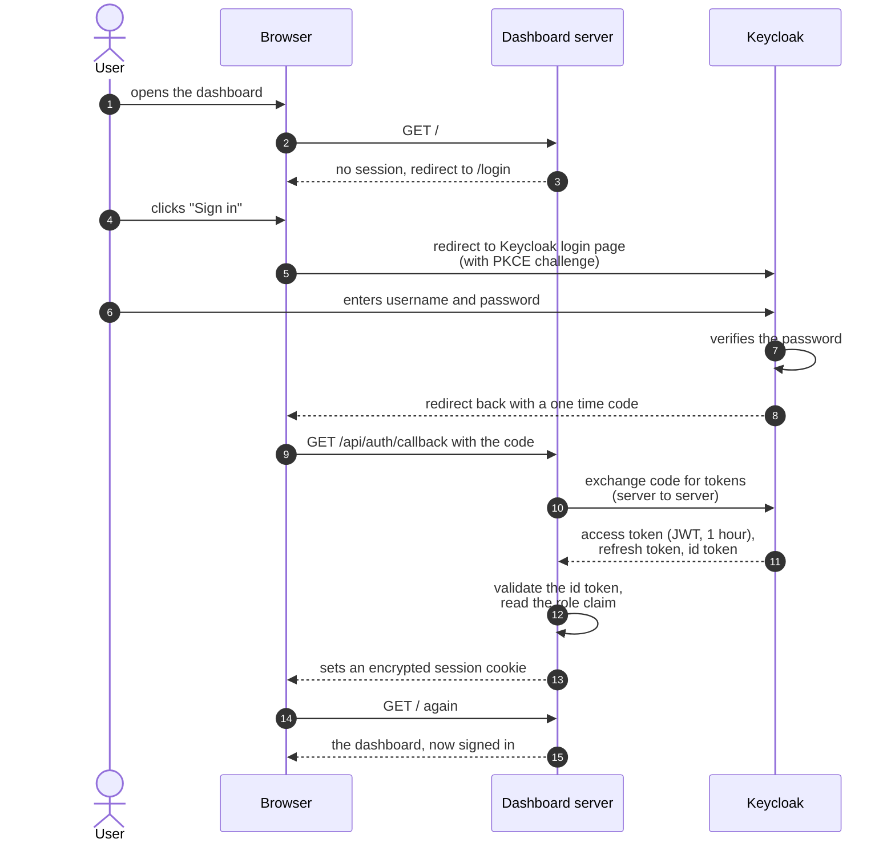

Points worth understanding:

- The **one time code** exists so the token never travels in a browser address bar where it
  could be logged or copied. The real token is fetched by the dashboard's server.
- **PKCE** is a proof that the application which started the login is the same one
  finishing it. It stops an attacker who intercepts the code from using it.
- The access token lasts one hour. The refresh token lets the dashboard get a new access
  token silently, so the user is not thrown out mid task. If the refresh token has also
  expired, the session is cleared and the user is sent to log in cleanly.

## 9. Flow B: reading data

A customer opening the order list. Note that no custom backend code runs at all.

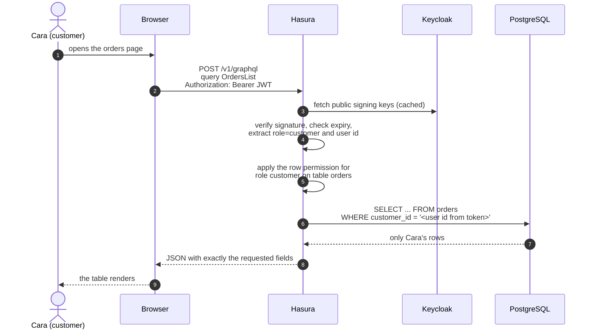

The security property here is important and easy to miss: the filter
`customer_id = user id from the token` is added by **Hasura**, not by the page. Even if
someone wrote their own query by hand and sent it with Cara's token, they would still only
ever receive Cara's orders. The same query sent with an `ops` token returns every order,
because a different permission applies to that role.

## 10. Flow C: changing an order

The full path of a state change, which is where all the interesting machinery lives.

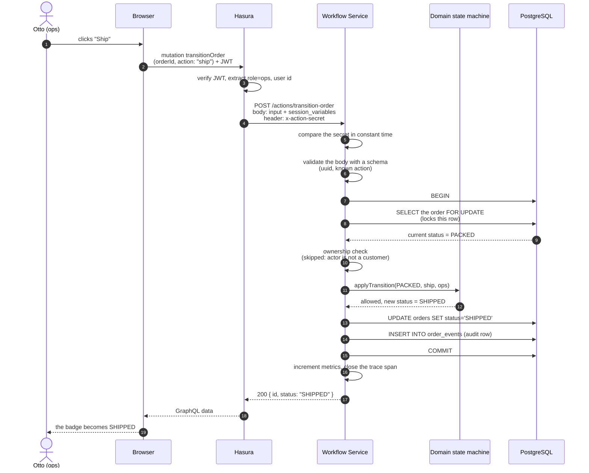

**What happens when a rule says no.** Suppose Cara, a customer, tries to pack an order. The
domain state machine throws a `ForbiddenTransitionError`. The service converts it into a
structured response, not a crash:

```json
{
  "errors": [
    {
      "message": "Role 'customer' may not 'pack' from 'CONFIRMED'",
      "extensions": { "code": "forbidden" }
    }
  ]
}
```

The dashboard shows that message inline. Every rejection has a machine readable `code`
(`forbidden`, `illegal-transition`, `insufficient-stock`, `not-found`, `bad-input`,
`unauthenticated`), which is what lets the frontend and the metrics treat different failures
differently.

**Why `SELECT ... FOR UPDATE` matters.** It locks the order row until the transaction ends.
If two warehouse workers click Ship at the same instant, one waits for the other. Without
the lock, both could read `PACKED`, both could decide the move is legal, and the order could
be shipped twice or have two conflicting audit rows.

## 11. Flow D: background work

Some work should not make the user wait, and must survive failure. Sending a notification is
a good example: nobody should stare at a spinner while an email is queued.

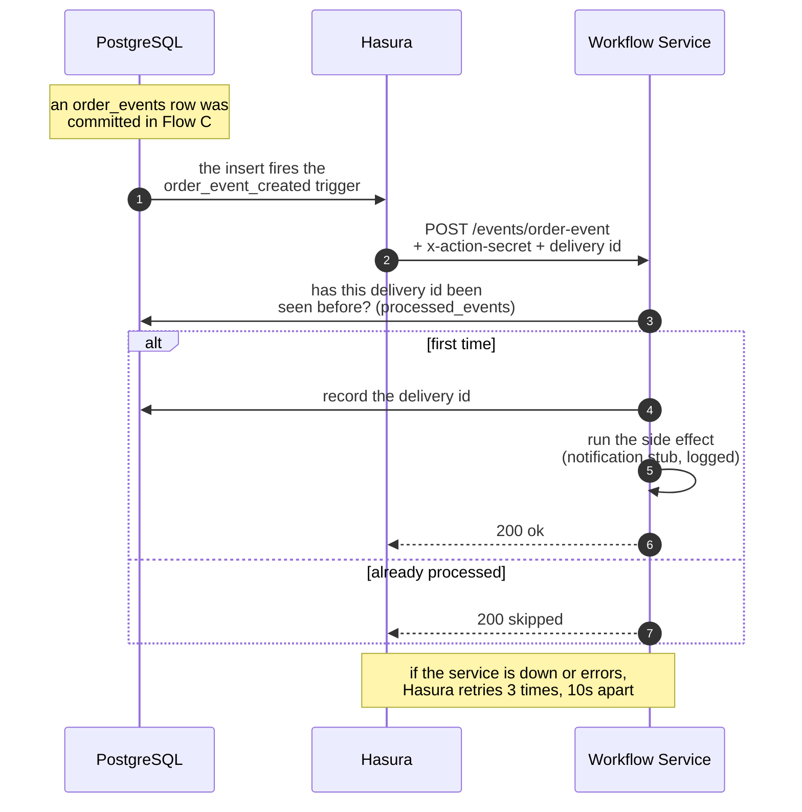

The key idea is **idempotency**: doing the same thing twice has the same result as doing it
once. Hasura guarantees *at least once* delivery, which means retries can deliver a
duplicate. The `processed_events` table makes duplicates harmless, so a customer never gets
the same notification twice.

**When to choose which path**, stated as a rule the project follows:

| Use a synchronous Action when | Use an asynchronous Event Trigger when |
|-------------------------------|----------------------------------------|
| The caller needs the result to continue | The work can happen after the reply |
| The user is waiting on screen | Nobody is waiting |
| Example: shipping an order | Example: sending the shipping notification |

---

# Part 4: Running and shipping it

## 12. Deployment topologies

The same application runs in three environments. Each is a step closer to production.

### 12.1 Local development, on your laptop

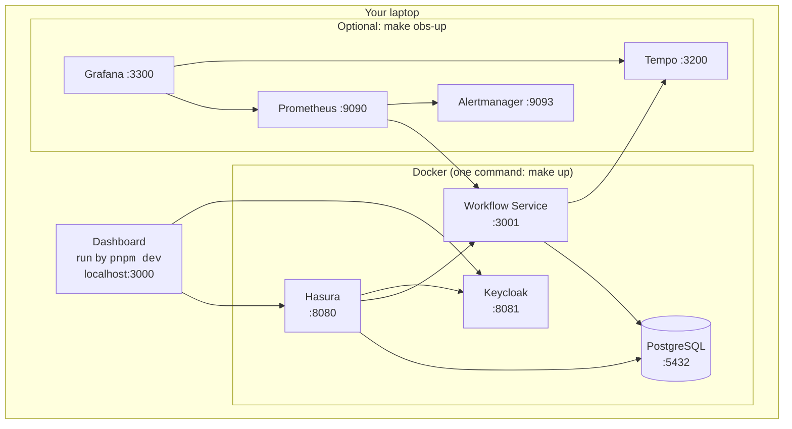

### 12.2 Kubernetes, on a local cluster

Proves the Helm chart works before any cloud spending. Verified on a `kind` cluster.

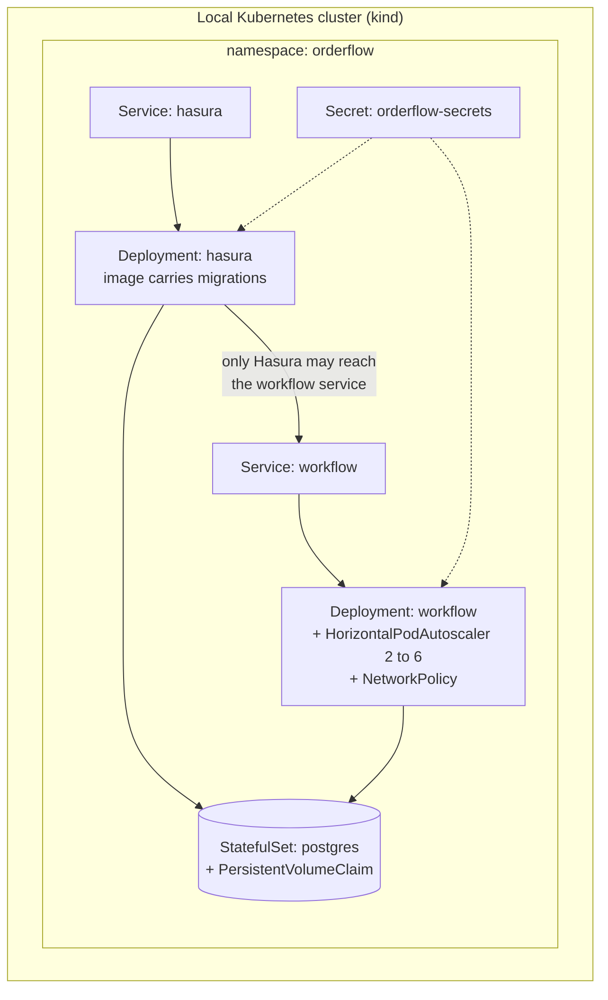

The **NetworkPolicy** is a firewall inside the cluster. It states that only Hasura pods may
open a connection to the Workflow Service. Even if another pod were compromised, it could
not call the service directly.

### 12.3 Google Cloud, production shape

Defined in Terraform. Written and validated, **not yet applied**.

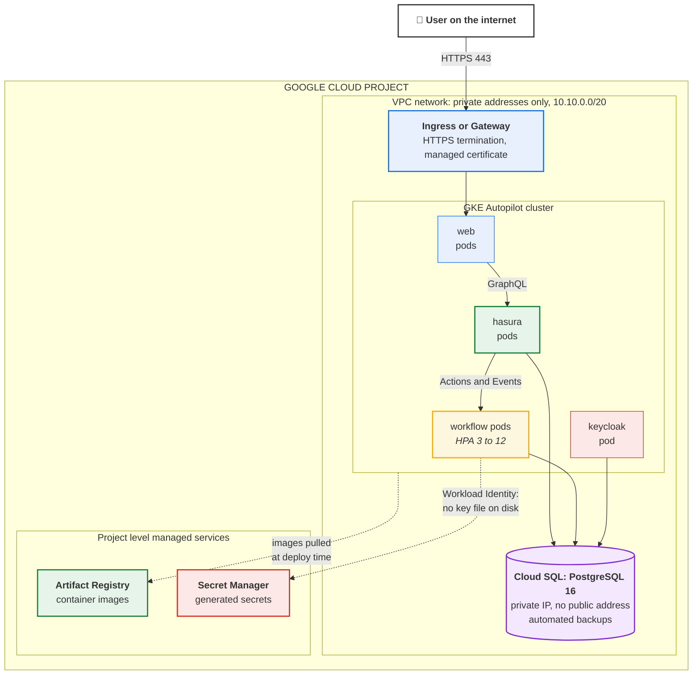

Two cloud specific ideas:

**Private IP.** The database has no public address at all. Nothing on the internet can
reach it, even with the correct password. Only workloads inside the VPC network can connect.

**Workload Identity.** Instead of putting a downloadable key file next to the application,
the Kubernetes service account is granted the right to *act as* a Google service account.
Google issues short lived credentials automatically. There is no long lived key to leak.

## 13. The CI/CD pipeline

Every push runs automated checks. Nothing reaches an image registry unless they pass.

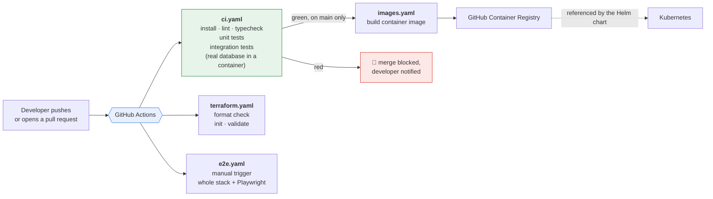

The end to end test workflow is deliberately **manual**. It starts the entire stack,
including a browser, which makes it slower and more prone to unrelated flakiness. Keeping it
off the automatic path means the always on signal stays trustworthy.

## 14. Running it on your own machine

You need [Docker](https://docs.docker.com/get-docker/), [Node.js 22](https://nodejs.org),
and pnpm 9 (`npm install -g pnpm@9`).

```bash
# 1. Get the code and its dependencies
git clone https://github.com/harishbala1o/ecommerce-orderflow.git
cd ecommerce-orderflow
pnpm install

# 2. Start the backend. This creates .env from .env.example on first run,
#    starts four containers, and applies the database migrations.
make up

# 3. Load sample data: 3 users, 12 products, one example order
make seed

# 4. Confirm the API works
make smoke

# 5. Start the dashboard in a second terminal
cd apps/web
cp .env.example .env.local     # first time only
pnpm dev
```

Open <http://localhost:3000> and sign in as `cara`, `otto`, or `ada`, all with the password
`demo1234`. To add the observability stack, run `make obs-up` instead of `make up` and open
Grafana at <http://localhost:3300>.

---

# Part 5: Project status

## 15. What has been implemented

The project was built in numbered milestones. All of Phase 1 is complete and verified by
running it, not just by writing it.

| Milestone | Scope | Status |
|-----------|-------|--------|
| **M1** | Monorepo tooling, shared configuration, and the order state machine | ✅ Complete |
| **M2** | PostgreSQL schema, versioned migrations, Hasura tracking, seed data, Docker Compose | ✅ Complete |
| **M3** | Order Workflow Service: Actions, Event Triggers, transactions, idempotency, integration tests | ✅ Complete |
| **M4** | Keycloak authentication, JWT to role mapping, row level permissions, the dashboard, end to end tests | ✅ Complete |
| **M5a** | Metrics, traces, structured logs, Grafana dashboard | ✅ Complete |
| **M5b** | CI/CD on GitHub Actions, image publishing | ✅ Complete |
| **M5c** | Helm chart with development and production overlays, verified on a local Kubernetes cluster | ✅ Complete |
| **M5d** | Architecture Decision Records and architecture documentation | ✅ Complete |
| **Phase 2** | Terraform for Google Cloud: written, formatted, and validated | ⚠️ Not applied |
| **Phase 3** | SLOs, error budget alerts, Alertmanager | ✅ Complete |

Repository facts at the time of writing: 54 commits, 4 continuous integration workflows,
6 Architecture Decision Records, 31 automated tests.

## 16. Features completed

**Product and workflow**

- Three roles with genuinely different capabilities, enforced in two independent layers.
- Full order lifecycle with seven statuses and nine legal transitions, each role gated.
- Stock reservation at confirmation time, atomic with the status change.
- Complete append only audit history for every order, visible in the interface.
- Order placement with a product catalogue of 12 items, with live stock levels.
- Structured, human readable errors for every rejection.

**Platform and operations**

- One command local environment covering five services.
- Database schema managed entirely by versioned migrations, applied automatically on start.
- Typed GraphQL client generated from the live schema, so a bad field name fails to compile.
- Metrics covering both request health and business activity, such as transitions by action
  and by role.
- Distributed tracing across the dashboard, Hasura, the service, and the database.
- Availability and latency SLOs with multi window burn rate alerting.
- Continuous integration on every push, container image publishing, Helm chart, and cloud
  infrastructure as code.

## 17. Features remaining

Ordered by what a real deployment would need first.

| # | Item | Why it is needed | Rough size |
|---|------|------------------|------------|
| 1 | **Dockerfile for the dashboard** | The Helm chart expects a `web` image, but only the Workflow Service has a Dockerfile. The dashboard currently runs only in development mode. | Small |
| 2 | **Ingress, TLS, and DNS** | Nothing terminates HTTPS or maps a domain name yet. | Small to medium |
| 3 | **Production ready Keycloak** | It currently runs in development mode with an in memory database. Production needs persistent storage, a fixed hostname, and production mode. | Medium |
| 4 | **Secret delivery into the cluster** | Terraform writes secrets to Secret Manager, but nothing yet syncs them into Kubernetes. Needs the External Secrets Operator or the Secret Manager CSI driver. | Medium |
| 5 | **Continuous deployment** | Images are built and published, but deployment to a cluster is still manual. | Small |
| 6 | **Apply the Terraform** | The cloud environment does not exist yet. Requires a billing enabled Google Cloud project. | Small, but incurs cost |
| 7 | **Real notification provider** | The notification side effect is a stub that only logs. | Small |
| 8 | **Realtime updates in the interface** | The dashboard refetches after changes. Hasura supports subscriptions, which would push updates instead. | Small |
| 9 | **Log shipping** | Logs are structured and correlated but are only written to standard output. Loki or an equivalent would make them searchable. | Small |
| 10 | **Separate database users per service** | Hasura and the Workflow Service currently share one database account. Least privilege would give each its own. | Medium |

## 18. Known limitations

Stated plainly, because a document that hides limitations is not useful.

**Product scope**

- There is no storefront, no cart, and no payment. Payment is modelled as a status, not
  integrated.
- There is no partial shipment, no split order, and no backorder. An order moves as a whole.
- There is no product management interface. The catalogue comes from seed data.
- Returns record a status change only. There is no refund flow.

**Technical**

- **Keycloak in development mode.** Convenient locally, not suitable for production.
- **The dashboard is not containerised.** See item 1 above.
- **No rate limiting.** Deliberately deferred, because the correct place for it is the
  ingress or an API gateway, not the internal service whose only caller is Hasura.
- **No Content Security Policy.** Baseline security headers are set, but a full policy needs
  care to avoid breaking the login redirect and was postponed.
- **Single writer bottleneck.** All order writes funnel through one service. This is a
  deliberate correctness choice, and it scales by adding service replicas, but it is a
  design constraint worth naming.
- **Demo credentials are committed.** The `.env.example` files and the Keycloak realm
  contain development only passwords, clearly labelled as such, so that a fresh clone runs
  with one command. Production must generate new ones with `make gen-secrets`.
- **Fixed identifiers in seed data.** Deliberate, because tests depend on them and Keycloak
  user ids must match database rows. Not appropriate for production data.

**Operational**

- The observability stack stores data locally with no retention policy and no persistence
  across restarts.
- Alertmanager has no real delivery destination configured. Alerts appear in its interface
  only.
- There is no backup or restore procedure documented beyond Cloud SQL's automated backups.
- There is no load testing, so no evidence based capacity numbers exist.

## 19. Future roadmap

```mermaid
flowchart LR
    subgraph N["NOW: production readiness"]
        A1["Dashboard image<br/>+ ingress and TLS"]
        A2["Production Keycloak"]
        A3["Secret sync<br/>+ continuous deployment"]
    end
    subgraph M["NEXT: confidence"]
        B1["Load testing with k6<br/>real capacity numbers"]
        B2["Log shipping<br/>+ retention"]
        B3["Backup and restore<br/>rehearsal"]
    end
    subgraph L["LATER: depth"]
        C1["Inventory as a second<br/>bounded context"]
        C2["Transactional outbox<br/>for event delivery"]
        C3["Canary or blue green<br/>releases"]
    end
    N --> M --> L
    style N fill:#fce8e6,stroke:#d93025
    style M fill:#fef7e0,stroke:#f9ab00
    style L fill:#e6f4ea,stroke:#188038
```

**Now: production readiness.** Everything in Part 17, items 1 to 6. Without these the
system cannot serve real users over the internet.

**Next: confidence.** Load testing to replace guesses about capacity with measurements.
Searchable logs. A rehearsed restore, because an untested backup is not a backup.

**Later: depth.** An inventory service as a genuinely separate bounded context, which would
turn this into a multi service architecture. A transactional outbox, which is the rigorous
way to guarantee that an event is published exactly when its transaction commits. Progressive
delivery so a bad release affects a fraction of traffic rather than everyone.

---

# Part 6: Testing

## 20. Tests already performed

### 20.1 Automated tests

31 automated tests run on every push to GitHub.

| Suite | Count | Type | What it proves |
|-------|-------|------|----------------|
| `packages/domain` | 19 | Unit | Every legal transition is allowed, every illegal one is rejected, every role gate holds, and the "is it final" rule is derived from the transition table rather than duplicated |
| `packages/config` | 4 | Unit | Invalid configuration fails immediately at start up with a readable message, rather than causing a mysterious failure later |
| `apps/workflow-service` | 6 | Integration | Against a **real PostgreSQL database** started in a container: the full lifecycle, stock decrement on confirm, a customer cancelling their own order, ownership enforcement, rejection of illegal transitions, and transaction rollback when stock is insufficient |
| `apps/web/e2e` | 2 | End to end | With a real browser against the whole running stack: a customer places an order and an operations user fulfils it through to delivered with the audit trail visible, and a customer cannot open another customer's order |

Every push also runs linting, TypeScript type checking across all seven packages, and
Terraform format and validity checks.

### 20.2 Manual and exploratory verification performed

These were checked by hand during development and confirmed working:

- **Authentication:** login as all three personas, sign out, federated sign out ending the
  Keycloak session, session expiry behaviour, and recovery from an unusable stale session.
- **Authorisation:** a customer sees only their own orders; operations and admin see all;
  the action buttons offered differ correctly by role and status; force cancelling a shipped
  order is offered to admin only.
- **Rejection paths:** forbidden transition, illegal transition, insufficient stock, unknown
  product, and missing action secret, each returning the correct structured code.
- **API layer:** row and column permissions verified with real tokens and no administrative
  secret; queries, filters, aggregates, and relationship traversal.
- **Data layer:** migrations applying cleanly from empty, metadata consistency confirmed
  through the Hasura API, and the seed being safely re runnable.
- **Observability:** metrics present with correct labels, Prometheus scraping successfully,
  traces arriving in Tempo, both Grafana dashboards rendering with live data, SLO recording
  rules evaluating, and Alertmanager connected.
- **Kubernetes:** Helm chart linted, both value overlays rendered, and the core path deployed
  to a real local cluster with migrations self applying and the API returning seeded data.
- **Security fixes:** each remediation from the security review re verified after the change.

## 21. Tests still required before production

This is a gap list, not a wish list. Nothing here has been done.

### 21.1 Functional tests

| Test | Why it matters |
|------|----------------|
| Every one of the nine transitions driven through the interface by every role | The automated suite covers the domain exhaustively and one happy path through the browser. The full matrix through the interface is not covered. |
| Return flow after delivery, end to end in the browser | `DELIVERED` to `RETURNED` is unit tested but never exercised through the interface. |
| Admin force cancel of a shipped order, end to end | The highest privilege action in the system, currently verified only at the unit level. |
| Multi item orders with mixed stock availability | Only single and two item orders have been exercised. |
| Empty states and pagination with hundreds of orders | The list currently renders every order with no pagination at all. |

### 21.2 Integration tests

| Test | Why it matters |
|------|----------------|
| Event Trigger retry and eventual success after the service is temporarily down | Retry behaviour is configured and reasoned about but never actually provoked. |
| Duplicate event delivery, asserting the idempotency table prevents a repeated side effect | The mechanism exists and is unit level tested; the real duplicate path is not. |
| Hasura metadata and Action contract drift detection | If a schema changes and the service is not updated, the failure should be caught in CI rather than at runtime. |
| Token expiry mid session, asserting silent refresh | The refresh path is implemented and the failure branch was verified, but a genuine mid session expiry was never waited out. |
| Database connection loss and recovery | Pool limits and timeouts are configured; behaviour during an outage is unverified. |

### 21.3 Performance tests

| Test | Target to establish |
|------|--------------------|
| Load test the read path | Requests per second at acceptable latency, and where it degrades |
| Load test the transition path | Write throughput, and the effect of row locking under contention |
| Concurrency test: many workers transitioning the same order simultaneously | Exactly one should win each transition; no duplicate audit rows |
| Soak test over several hours | Detect memory leaks, connection pool exhaustion, and slow degradation |
| Autoscaling verification under load | Confirm the HorizontalPodAutoscaler actually adds replicas and that they help |
| Database query plan review with a realistic data volume | Confirm the current indexes hold up beyond seed sized data |

### 21.4 Security tests

| Test | Why it matters |
|------|----------------|
| Token tampering: altered claims, wrong signature, expired, and none algorithm | The single most important defence in the system deserves explicit adversarial tests |
| Direct calls to the Workflow Service bypassing Hasura, without and with a wrong secret | Verified once by hand, should be an automated regression test |
| Cross user access attempts on every table and relationship | Row permissions were verified for orders, and should be proven for items, events, and users |
| Dependency and container image vulnerability scanning in CI | Currently no automated supply chain scanning exists |
| Secret scanning on the repository history | Guards against a future accidental commit |
| Denial of service probing of the ingress once rate limiting exists | Rate limiting is deferred, so its eventual configuration needs proving |
| Full authentication flow review against OIDC best practice, including logout everywhere | Login was built to the standard, but never audited against it end to end |

### 21.5 Edge case tests

| Case | Expected behaviour |
|------|--------------------|
| Placing an order for a product whose stock reaches zero between placement and confirmation | Confirmation fails with `insufficient-stock`, and nothing is written |
| Two simultaneous cancel attempts on the same order | One succeeds, the other reports an illegal transition |
| Quantity at the validation boundaries: 0, 1, 1000, 1001, and negative | Rejected outside the range, accepted inside it |
| An order with the maximum 100 line items, and one with 101 | Accepted and rejected respectively, without a slow request |
| Clock skew between Keycloak and the services | Tokens should not be rejected by small differences; the 30 second allowance should hold |
| Restarting each service in turn while traffic flows | Requests should fail cleanly and recover, never corrupt data |
| A very long product name or description in the interface | Layout should not break |
| Currency and rounding at large totals | Cent arithmetic should stay exact |

---

# Part 7: Google Cloud deployment guide

This part assumes no prior cloud experience. Follow it in order.

> **Cost warning, please read.** The resources below are not free. A Kubernetes cluster and
> a managed database together cost roughly a few US dollars per day, billed by the hour and
> charged whether or not anyone uses the system. Treat this as: create it, demonstrate it,
> then **destroy it**. Step 8 shows how to remove everything. New Google Cloud accounts
> usually include free trial credit which comfortably covers a demonstration.

## 22. Prerequisites

**Accounts**

1. A Google account.
2. A Google Cloud project with **billing enabled**. Create one at
   <https://console.cloud.google.com/projectcreate>, then attach a billing account.

**Tools on your machine**

| Tool | Purpose | Install |
|------|---------|---------|
| `gcloud` | Google Cloud command line | <https://cloud.google.com/sdk/docs/install> |
| `terraform` (1.6 or newer) | Creates the cloud resources | `brew install hashicorp/tap/terraform` |
| `kubectl` | Talks to the Kubernetes cluster | `gcloud components install kubectl` |
| `helm` (3 or newer) | Installs the application into the cluster | `brew install helm` |
| `docker` | Builds container images | <https://docs.docker.com/get-docker/> |
| `git` | Fetches the source | usually preinstalled |

Confirm each one:

```bash
gcloud version && terraform version && kubectl version --client && helm version && docker --version
```

**Knowledge.** None beyond this document. Every command is given in full.

## 23. Google Cloud services used

| Service | Plain description | Why this project needs it |
|---------|-------------------|---------------------------|
| **Google Kubernetes Engine (Autopilot)** | Runs containers, and Google manages the underlying machines | Runs all four application containers, restarts and scales them |
| **Cloud SQL for PostgreSQL** | A managed database, with backups and patching handled for you | Stores all order data, with no public address |
| **Artifact Registry** | A private store for container images | Holds the images the cluster pulls |
| **Secret Manager** | An encrypted store for passwords and keys | Keeps secrets out of images and out of git |
| **Virtual Private Cloud** | A private network inside Google Cloud | Lets the cluster reach the database privately |
| **Cloud Storage** | File storage | Holds the Terraform state file, which records what exists |
| **IAM** | Decides which identity may do what | Grants the application exactly the two permissions it needs |

Terraform enables the required APIs for you. An **API** here means a Google Cloud feature
that must be switched on for a project before use.

## 24. Environment variables and secrets

An **environment variable** is a named value handed to a program when it starts. Secrets are
environment variables that must never appear in source control.

### 24.1 Generated for you by Terraform

These are created with strong random values and stored in Secret Manager. You never type
them.

| Secret name | Used by | Purpose |
|-------------|---------|---------|
| `orderflow-admin-secret` | Hasura | Full administrative access to the API |
| `orderflow-action-secret` | Hasura and the Workflow Service | Proves a request came from Hasura |
| `orderflow-postgres-password` | Database clients | Database account password |
| `orderflow-database-url` | Hasura and the Workflow Service | Full private connection string |
| `orderflow-nextauth-secret` | Dashboard | Encrypts the browser session cookie |
| `orderflow-keycloak-admin-password` | Keycloak | Its administrative account |

### 24.2 Values you must supply

In `infra/terraform/terraform.tfvars`, copied from the provided example:

| Variable | Meaning | Example |
|----------|---------|---------|
| `project_id` | Your Google Cloud project id | `orderflow-demo-4821` |
| `region` | Where to create resources | `us-central1` |
| `environment` | A name used in resource names | `prod` |
| `db_tier` | Database size | `db-g1-small` |

### 24.3 Non secret configuration for the application

Set through Helm values, not secrets:

| Variable | Meaning |
|----------|---------|
| `NEXT_PUBLIC_GRAPHQL_URL` | The public API address the browser calls |
| `KEYCLOAK_ISSUER` | The public address of your Keycloak realm |
| `NEXTAUTH_URL` | The public address of the dashboard |
| `HASURA_GRAPHQL_CORS_DOMAIN` | The only browser origin allowed to call the API |

> Anything prefixed `NEXT_PUBLIC_` is **visible to anyone using the site**. Never put a
> secret behind that prefix.

## 25. Step by step deployment

### Step 1: sign in and select your project

```bash
gcloud auth login
gcloud auth application-default login
gcloud config set project YOUR_PROJECT_ID
```

The second command creates the credentials Terraform itself uses.

### Step 2: create a bucket for Terraform state

Terraform records what it has created in a **state file**. Keeping it in Cloud Storage
rather than on your laptop means it is durable and shareable. The name must be globally
unique.

```bash
gsutil mb -l us-central1 gs://orderflow-tfstate-YOUR-UNIQUE-SUFFIX
```

### Step 3: configure and review the plan

```bash
cd infra/terraform
cp terraform.tfvars.example terraform.tfvars
# edit terraform.tfvars and set project_id

terraform init -backend-config="bucket=orderflow-tfstate-YOUR-UNIQUE-SUFFIX"
terraform plan
```

`terraform plan` changes nothing. It prints what **would** be created. Read it. You should
see roughly 20 resources to add, including one cluster, one database instance, and several
secrets.

### Step 4: create the infrastructure

```bash
terraform apply
```

Type `yes` when prompted. This takes **15 to 25 minutes**, mostly waiting for the cluster
and the database. When it finishes it prints outputs you will need next:

```bash
terraform output
```

### Step 5: connect kubectl to the new cluster

```bash
gcloud container clusters get-credentials "$(terraform output -raw cluster_name)" \
  --region "$(terraform output -raw cluster_location)"

kubectl get nodes
```

### Step 6: build and push the container images

Replace `REPO` with the value of `terraform output -raw artifact_registry_repo`.

```bash
cd ../..                       # back to the repository root
REPO=$(cd infra/terraform && terraform output -raw artifact_registry_repo)
gcloud auth configure-docker "$(echo "$REPO" | cut -d/ -f1)"

# The Hasura image carries the database migrations and metadata
docker build -f infra/docker/hasura.Dockerfile -t "$REPO/hasura:v1" .
docker push "$REPO/hasura:v1"

# The Workflow Service
docker build -f apps/workflow-service/Dockerfile -t "$REPO/workflow-service:v1" .
docker push "$REPO/workflow-service:v1"
```

> **Known gap.** There is no Dockerfile for the dashboard yet, so there is no `web` image to
> push. Deploy with `--set web.enabled=false` for now and reach the API directly, or write
> the Dockerfile first. This is item 1 in Part 17.

### Step 7: install the application

Create the namespace and the service account that Workload Identity binds to:

```bash
kubectl create namespace orderflow
kubectl -n orderflow create serviceaccount orderflow
kubectl -n orderflow annotate serviceaccount orderflow \
  iam.gke.io/gcp-service-account="$(cd infra/terraform && terraform output -raw workload_service_account)"
```

Create the Kubernetes secret the chart expects, reading the values from Secret Manager:

```bash
kubectl -n orderflow create secret generic orderflow-secrets \
  --from-literal=admin-secret="$(gcloud secrets versions access latest --secret=orderflow-admin-secret)" \
  --from-literal=action-secret="$(gcloud secrets versions access latest --secret=orderflow-action-secret)" \
  --from-literal=database-url="$(gcloud secrets versions access latest --secret=orderflow-database-url)" \
  --from-literal=postgres-password="$(gcloud secrets versions access latest --secret=orderflow-postgres-password)" \
  --from-literal=nextauth-secret="$(gcloud secrets versions access latest --secret=orderflow-nextauth-secret)" \
  --from-literal=keycloak-admin-password="$(gcloud secrets versions access latest --secret=orderflow-keycloak-admin-password)"
```

> For a real system, replace this manual step with the External Secrets Operator so
> Kubernetes stays in sync with Secret Manager automatically. This is item 4 in Part 17.

Install the chart with the production overlay:

```bash
helm install orderflow infra/helm/orderflow \
  -n orderflow \
  -f infra/helm/orderflow/values-prod.yaml \
  --set images.hasura="$REPO/hasura:v1" \
  --set images.workflowService="$REPO/workflow-service:v1" \
  --set web.enabled=false

kubectl -n orderflow rollout status deploy/orderflow-hasura
```

### Step 8: destroy everything when finished

This is the step people forget, and the reason for surprise bills.

```bash
helm uninstall orderflow -n orderflow
cd infra/terraform && terraform destroy
```

Afterwards, confirm in the Google Cloud console that no Kubernetes cluster and no Cloud SQL
instance remain.

## 26. Verifying the deployment

Work through these in order. Each one proves a different layer.

**1. All pods are running**

```bash
kubectl -n orderflow get pods
```

Every pod should be `Running` with its containers ready. `CrashLoopBackOff` means a
container keeps failing; see troubleshooting.

**2. The database accepted the migrations**

```bash
kubectl -n orderflow logs deploy/orderflow-hasura | grep -i "migrations"
```

**3. Hasura's metadata is consistent**

```bash
kubectl -n orderflow port-forward svc/orderflow-hasura 8080:8080 &

curl -s http://localhost:8080/v1/metadata \
  -H "x-hasura-admin-secret: $(gcloud secrets versions access latest --secret=orderflow-admin-secret)" \
  -H 'Content-Type: application/json' \
  -d '{"type":"get_inconsistent_metadata","args":{}}'
```

Expect `{"inconsistent_objects":[],"is_consistent":true}`.

**4. The API answers a real query**

```bash
curl -s http://localhost:8080/v1/graphql \
  -H "x-hasura-admin-secret: $(gcloud secrets versions access latest --secret=orderflow-admin-secret)" \
  -H 'Content-Type: application/json' \
  -d '{"query":"{ products { sku name stock_qty } }"}'
```

**5. The Workflow Service is healthy and unreachable from outside**

```bash
kubectl -n orderflow exec deploy/orderflow-hasura -- \
  wget -qO- http://orderflow-workflow:3001/health
```

Expect `{"status":"ok"}`. Then confirm the NetworkPolicy works by trying the same call from
a pod that is not Hasura; it should fail.

**6. Autoscaling is configured**

```bash
kubectl -n orderflow get hpa
```

## 27. Troubleshooting

| Symptom | Likely cause | What to do |
|---------|--------------|------------|
| `terraform apply` fails with "API not enabled" | API enablement is still propagating | Wait 60 seconds and run `terraform apply` again |
| `terraform apply` fails on permissions | Your account lacks a role | Ask for `roles/owner` on the project, or the specific admin roles for GKE, Cloud SQL, and IAM |
| Pod stuck in `ImagePullBackOff` | The cluster cannot fetch the image | Check the image name matches the registry exactly, and that you ran `gcloud auth configure-docker` before pushing |
| Pod in `CrashLoopBackOff` | The container exits on start up | `kubectl -n orderflow logs <pod> --previous`. A missing environment variable is the usual cause; the service validates its configuration and exits with a clear message |
| Hasura logs "Inconsistent Metadata" on first start | Expected on a first boot; metadata is applied before migrations on a temporary server, then reconciled | Confirm with the `get_inconsistent_metadata` call in Part 26. If it reports consistent, there is no problem |
| Hasura cannot reach the database | Private networking not ready, or a wrong connection string | Confirm `terraform output db_private_ip`, and that the `database-url` secret uses that private address |
| `Could not verify JWT: JWTExpired` | The access token has expired | The dashboard refreshes tokens automatically. If it persists, sign out and in again; check clock skew between services |
| Login redirects in a loop | `KEYCLOAK_ISSUER` or `NEXTAUTH_URL` does not match the address the browser actually uses | Set both to the exact public URL, including scheme and port |
| `401 invalid action secret` | Hasura and the service hold different secrets | Both read the same Kubernetes secret key; confirm the pods restarted after a change |
| Cannot reach anything from a browser | No ingress exists yet | Use `kubectl port-forward` for now, and see item 2 in Part 17 |
| A Kubernetes secret change has no effect | Pods read secrets at start up | `kubectl -n orderflow rollout restart deploy/orderflow-hasura deploy/orderflow-workflow` |

## 28. Recommended production configuration

Everything below is what should change before real users arrive. The Helm production
overlay already sets several of these.

**Security**

| Setting | Value | Reason |
|---------|-------|--------|
| `HASURA_GRAPHQL_DEV_MODE` | `false` | Prevents detailed internal errors reaching clients |
| `HASURA_GRAPHQL_ENABLE_CONSOLE` | `false` | Removes the administrative interface from the public surface |
| `HASURA_GRAPHQL_ADMIN_INTERNAL_ERRORS` | `false` | Same reasoning, for administrative calls |
| `HASURA_GRAPHQL_CORS_DOMAIN` | your dashboard origin only | Stops other websites calling the API with a user's credentials |
| TLS | Terminate HTTPS at the ingress with a managed certificate | Tokens must never travel unencrypted |
| Secrets | Regenerate everything with `make gen-secrets` | Never deploy the committed development values |
| Database accounts | One per service, least privilege | Limits the damage from one compromised component |
| Rate limiting | At the ingress | Protects against brute force and denial of service |
| Image scanning | In the pipeline | Catches known vulnerable dependencies before deployment |

**Reliability**

| Setting | Value | Reason |
|---------|-------|--------|
| Cloud SQL availability | `REGIONAL` | Survives the loss of a single zone |
| Backups and point in time recovery | Enabled, and **restore rehearsed** | An untested backup is not a backup |
| Deletion protection | Enabled on the database and the cluster | Prevents an accidental destroy |
| Replicas | Hasura 2 or more, Workflow Service 3 or more | No single pod is a single point of failure |
| Autoscaling | Workflow Service 3 to 12 on 75% processor use | Absorbs traffic peaks |
| Probes | Liveness and readiness on every service | Kubernetes restarts what is stuck and only sends traffic to what is ready |
| Pod disruption budgets | Add them | Prevents a maintenance event draining every replica at once |

**Operations**

| Setting | Value | Reason |
|---------|-------|--------|
| Alert delivery | A real destination in Alertmanager | An alert nobody receives is not an alert |
| SLOs | Availability 99.5%, latency 95% under 0.5 seconds | Already defined; review the targets against real traffic |
| Log retention | 30 days or more, in a searchable store | Incident investigation needs history |
| Trace sampling | Sample rather than record everything | Full tracing is expensive at volume |
| Dashboards | Keep them in git, as they are today | Reproducible, reviewable, and not lost when a dashboard is edited by hand |
| Runbooks | Write one per alert | The person paged at 3am should not have to improvise |

---

# Appendices

## Appendix A: Port and URL reference

| Service | Local URL | Purpose |
|---------|-----------|---------|
| Dashboard | <http://localhost:3000> | The user interface |
| Hasura GraphQL | <http://localhost:8080/v1/graphql> | The API endpoint |
| Hasura console | <http://localhost:8080/console> | Administrative interface, development only |
| Keycloak | <http://localhost:8081> | Login and identity administration |
| Workflow Service | <http://localhost:3001/health> | Health check |
| Workflow metrics | <http://localhost:3001/metrics> | Prometheus scrape endpoint |
| Prometheus | <http://localhost:9090> | Metrics and alert rules |
| Alertmanager | <http://localhost:9093> | Alert routing |
| Tempo | <http://localhost:3200> | Trace storage, queried through Grafana |
| Grafana | <http://localhost:3300> | Dashboards |
| PostgreSQL | `localhost:5432` | Database, for tools such as psql |

## Appendix B: Demo accounts

Development only. Password for all three is `demo1234`.

| Username | Name | Role | Use it to see |
|----------|------|------|---------------|
| `cara` | Cara Customer | customer | Placing orders and the restricted view |
| `otto` | Otto Ops | ops | Driving fulfilment |
| `ada` | Ada Admin | admin | Full visibility and override powers |

## Appendix C: Command reference

```bash
# Local environment
make up            # start Postgres, Keycloak, Hasura, Workflow Service
make obs-up        # the same plus Prometheus, Tempo, Alertmanager, Grafana
make seed          # load sample users, 12 products, and an example order
make smoke         # verify the API returns seeded data with relationships
make down          # stop the containers
make reset         # stop and also delete the database volume
make logs          # follow the container logs
make gen-secrets   # print fresh random secrets for a deployment

# Code quality, from the repository root
pnpm install
pnpm lint
pnpm typecheck
pnpm test          # unit and integration tests

# The dashboard
cd apps/web && pnpm dev
cd apps/web && pnpm test:e2e    # Playwright, needs the stack running

# Kubernetes
helm lint infra/helm/orderflow
helm template orderflow infra/helm/orderflow

# Terraform
terraform -chdir=infra/terraform fmt -check -recursive
terraform -chdir=infra/terraform validate
```

## Appendix D: Repository map

```
ecommerce-orderflow/
├── apps/
│   ├── web/                     Next.js dashboard (frontend)
│   │   ├── app/                 pages: orders list, order detail, new order, login
│   │   ├── components/          shared interface pieces
│   │   ├── lib/                 authentication, GraphQL client, formatting
│   │   └── e2e/                 Playwright end to end tests
│   └── workflow-service/        NestJS service (business logic)
│       ├── src/orders/          Actions: place and transition orders
│       ├── src/events/          Event Trigger handler with idempotency
│       ├── src/db/              connection pool and repository
│       ├── src/observability/   metrics, tracing
│       ├── src/common/          auth guard, error mapping, session parsing
│       └── test/                Testcontainers integration tests
├── packages/
│   ├── domain/                  ★ the order state machine, framework free
│   ├── config/                  validated environment loading
│   └── graphql-client/          generated typed GraphQL operations
├── hasura/
│   ├── migrations/              versioned schema changes
│   ├── metadata/                tracked tables, permissions, Actions, Event Triggers
│   └── seeds/                   sample data
├── infra/
│   ├── docker/                  Compose files, Dockerfiles, smoke test
│   ├── helm/orderflow/          Kubernetes chart with dev and prod overlays
│   ├── keycloak/                the realm definition
│   └── terraform/               Google Cloud infrastructure as code
├── observability/
│   ├── prometheus/              scrape configuration and SLO rules
│   ├── alertmanager/            alert routing
│   └── grafana/                 provisioned datasources and dashboards
├── docs/
│   ├── ARCHITECTURE.md          this document
│   ├── slo.md                   SLO definitions and error budget policy
│   └── adr/                     6 Architecture Decision Records
├── .github/workflows/           CI, image publishing, end to end, Terraform
├── Makefile                     the friendly command front door
├── README.md                    quick start
├── PROJECT_CONTEXT.md           status and handover notes
└── SECURITY.md                  threat model and security posture
```

---

## Where to go next

| If you want to | Read |
|----------------|------|
| Understand why a decision was made | [`docs/adr/`](adr/) |
| Understand the security model | [`SECURITY.md`](../SECURITY.md) |
| Understand the SLOs and alerts | [`docs/slo.md`](slo.md) |
| Get running quickly | [`README.md`](../README.md) |
| Pick up development | [`PROJECT_CONTEXT.md`](../PROJECT_CONTEXT.md) |
